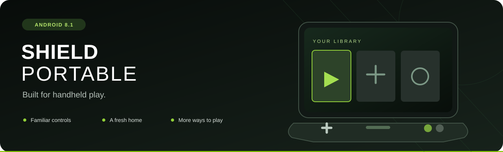
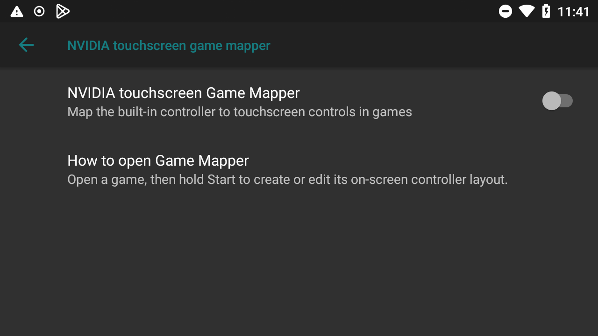
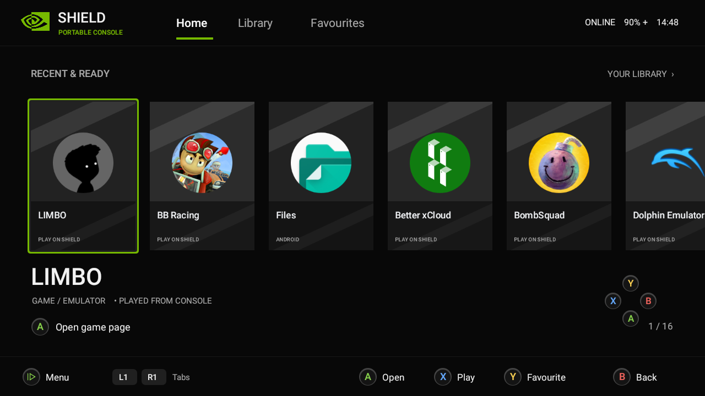
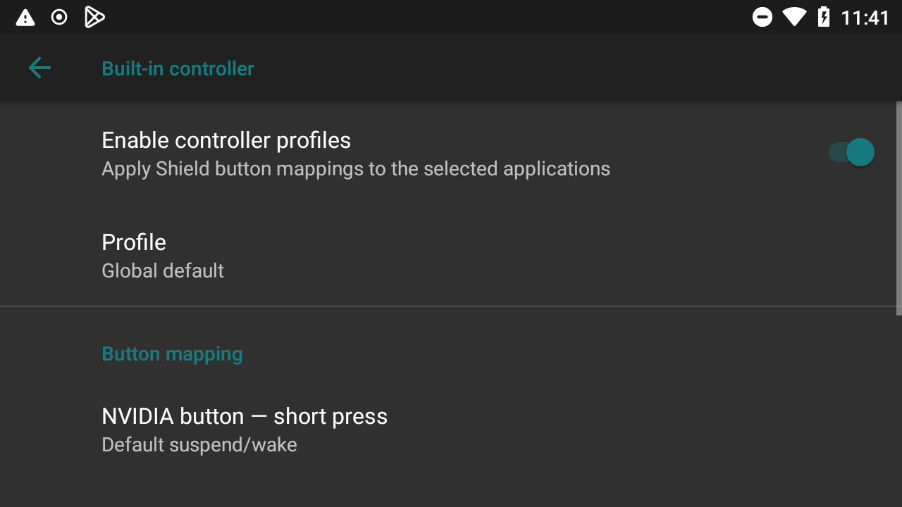
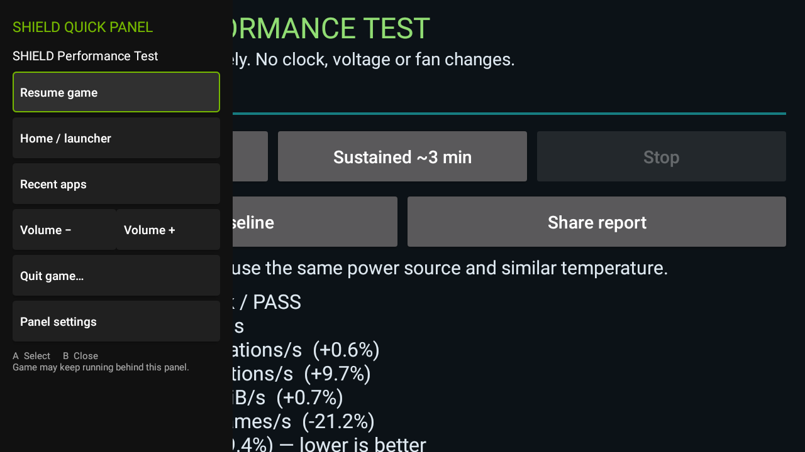
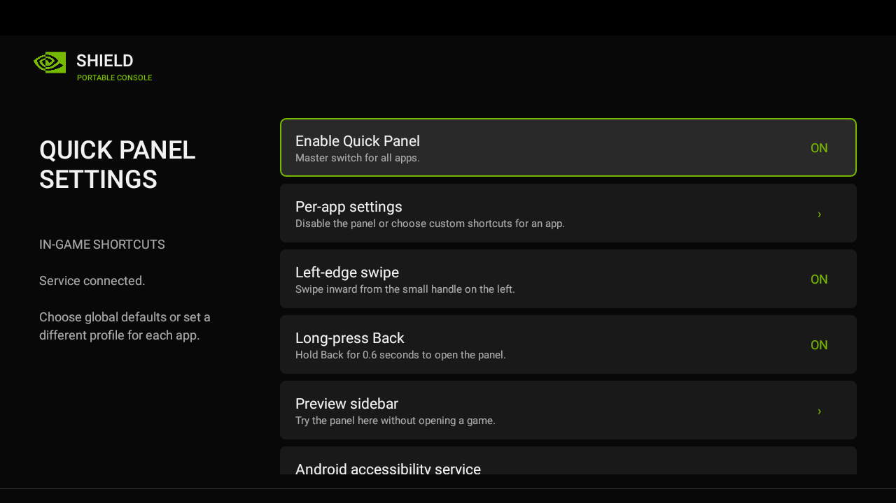
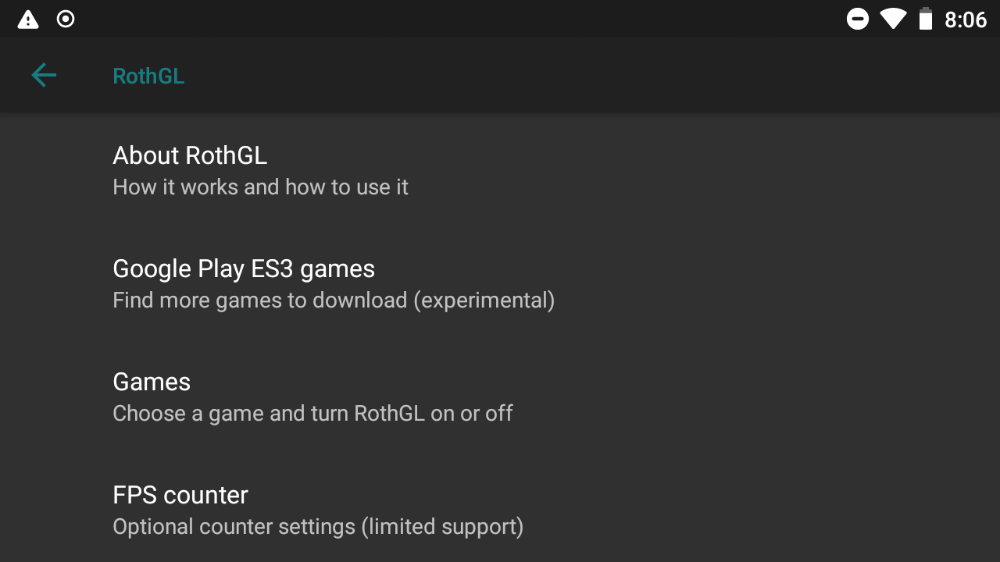

  

  <b>Your Portable. A fresh home. Familiar controls.</b> 
  Android 8.1 with a controller-friendly launcher and useful SHIELD features in one place.

  <a href="docs/INSTALL.md"><b>Installation &amp; downloads</b></a> ·
  <a href="#original-shield-features"><b>Original features</b></a> ·
  <a href="#whats-new"><b>What's new</b></a> ·
  <a href="docs/SETTINGS.md"><b>Settings guide</b></a>

> **Documentation preview — ROM download is not available yet.**
> A local ROM build has passed a clean setup with Google apps, restart and sleep/wake checks. Download availability is still pending. Do not flash a different ROM using this guide.

## What works

The tested installation has working **built-in controls, touchscreen, speakers, Wi-Fi, storage, launcher, restart and sleep/wake**. Google Play also works with the optional Google-apps setup.

The complete package still needs its final accessory checks. Results below distinguish restored features from checks of the complete package.

## Original SHIELD features

| Feature | What you can do | Testing note |
|---|---|---|
| **Built-in gamepad** | Play with the sticks, triggers and physical buttons. | Controls and touch confirmed on the tested installation. |
| **Console Mode** | Play on an HDMI display at 1080p, with the Portable screen off; return to Mirror Mode to use both screens. | Picture, screen-off and TV sound confirmed with the restored component; final package recheck pending. |
| **NVIDIA Game Mapper** | Map the built-in controller to touchscreen controls. Enable it, open a game, then hold **Start**. | Original NVIDIA mapper integrated; support depends on the game. |
| **Wireless SHIELD Controller** | Settings for the **2015 P2570** controller: battery, connection, device details and pairing. | Connection and buttons confirmed with the restored component; final package recheck pending. |
| **MicroSD storage** | Use a card separately, or adopt a suitable card as internal storage. | Storage checked. Adoption erases the card and ties it to this installation. |

These are retained or adapted NVIDIA features inside an **unofficial ROM**, not an official NVIDIA update. The wireless controller uses Wi-Fi Direct; streaming and controller use share the radio.

<b>See the NVIDIA Game Mapper setting</b>

Open **Settings → Shield settings → Controller settings → NVIDIA touchscreen game mapper**. Enable the switch, then hold **Start** inside a game to create or edit its touch layout.

## What's new

### A home screen made for the controller

*Example library. Games and apps shown are not included.*

**SHIELD Console** becomes your home after a fresh setup. Navigate with the D-pad, stick or touch. Choose app icons or covers, mark favourites and use the Start menu for shortcuts. Fresh setup uses **Dark style with a Black background**.

**A** selects · **B** goes back · **X** quick-launches · **Start** opens the menu.

### Your buttons, your choice

Map **Back, Sound and the NVIDIA short press** globally or for one app. Choose actions such as **Select** or **Guide** for supported games and streaming apps. The NVIDIA long press still opens the power menu; the separate Home button stays Home.

### Quick Panel, without leaving your game

*Quick Panel captured on the SHIELD. The background app is not included.*

Swipe from the left or hold **Back** for shortcuts to Home, recent apps, volume, cooling and Quit. Turn it off for individual apps when you want uninterrupted streaming. It needs your permission to enable its Accessibility service.

<b>See the Quick Panel settings</b>

### RothGL: optional graphics help

Choose a game, turn **Use RothGL** on, and try it. Turn it off to return to normal graphics. An optional FPS counter works with supported profiles.

**Show more ES3 games** may make more downloads visible in Google Play; it does not guarantee they will run. RothGL is experimental and **does not provide complete ES3 support**.

### Cooling that fits how you play

Choose **Quiet**, **Performance**, **Maximum cooling**, or **Auto**. Auto adds cooling for the apps you select and returns to Quiet elsewhere and with the screen off. It needs the Quick Panel Accessibility service; the sidebar itself can stay off.

## Ready to get started?

**[Open installation & downloads →](docs/INSTALL.md)**

**[Explore every SHIELD setting →](docs/SETTINGS.md)**

Google apps are optional; follow the installation guide to add them. Screenshots show the interface, not required switch positions; appearance may vary with your theme.

---

**Original SHIELD Portable (`roth`) only — not SHIELD Tablet or SHIELD TV.** Back up before installing. Android 8.1 does not have current security protection; avoid sensitive accounts and data. Some accessories and long-session behaviour still need testing.

[Credits & download notices](NOTICE.md)
