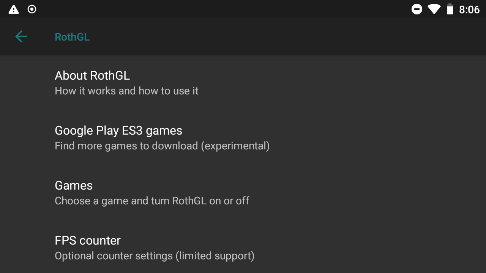
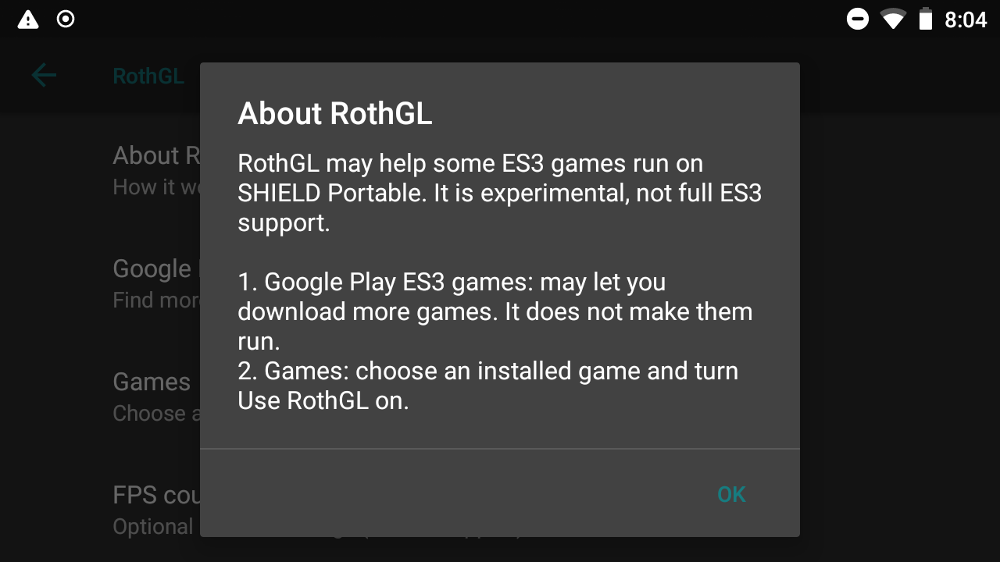
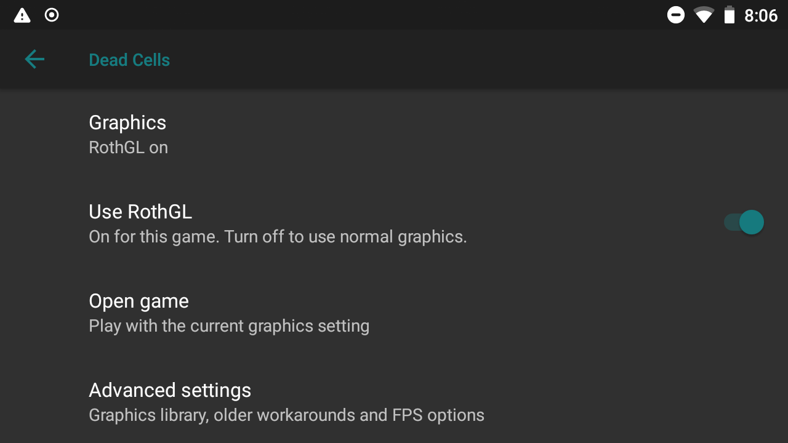
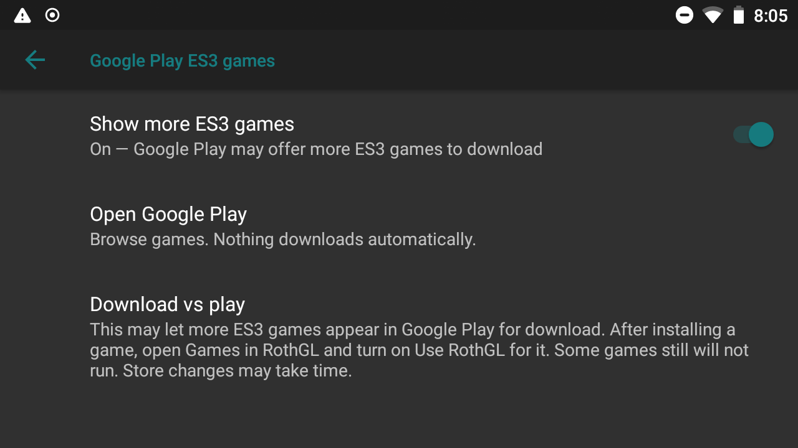

# Pictures and video

## Current development settings

These are real development-device screenshots. They show the newer Settings component; the older private full-ROM ZIP does not yet contain this entire layout. They contain no account screen or personal network name.

### RothGL home

### About RothGL

### Per game controls

### Google Play options

## Bootloader video

[How To Unlock the NVIDIA Shield's Bootloader](https://www.youtube.com/watch?v=7Am5WYRojMs) is a 2013 third-party video for the original Portable. It is a historical visual reference, not an installation guide for this Android 8.1 ROM. Follow this project's written release notes for files, recovery size, and installation order. Video playback/content has not been reviewed end-to-end for this release.

Do not follow its old rooting/download links or use SHIELD TV/Tablet instructions. No verified video for installing this project's finished ROM exists yet.

## Video to record before release

A release walkthrough should show the exact published version: backup warning, correct files and checksums, unlock warning, recovery, installation, first setup, Console, controller remapping, Quick Panel, fan choices, and RothGL on/off. Hide serial numbers, account details, Wi-Fi names, and debugging addresses before publishing.
