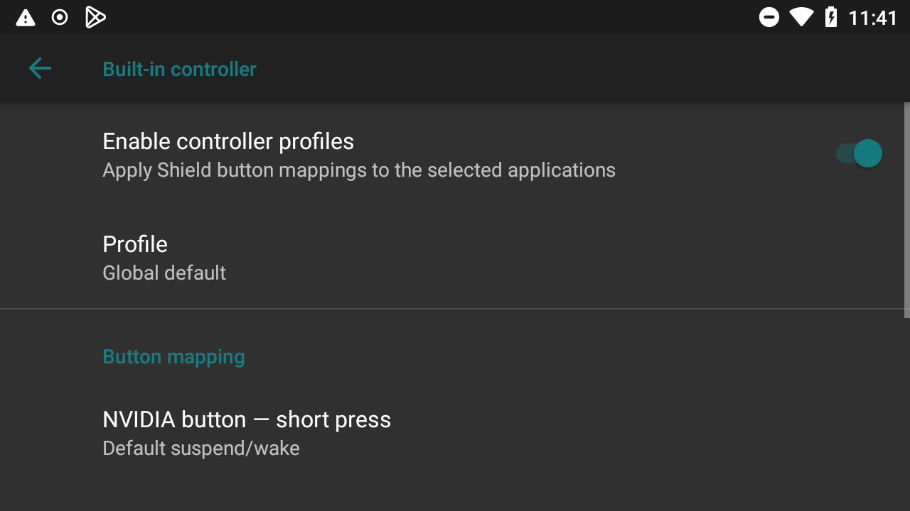
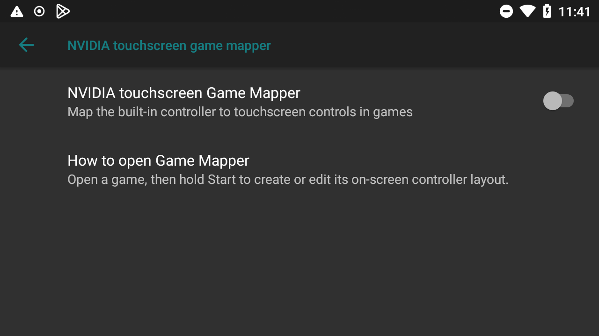
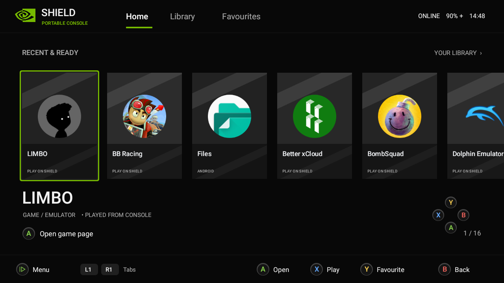
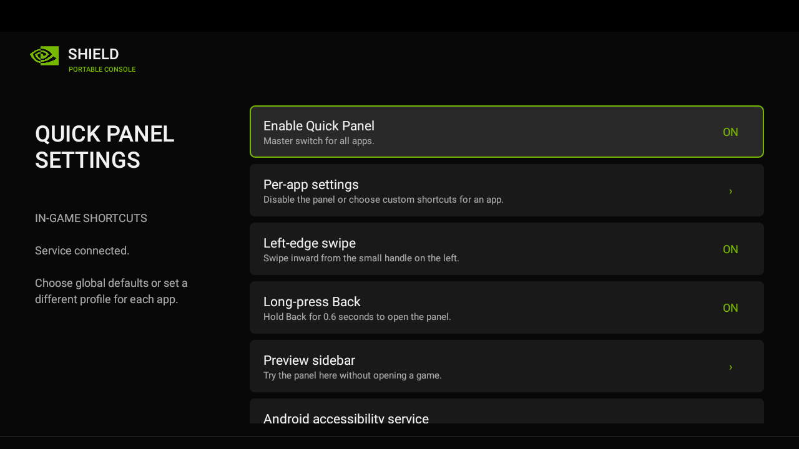
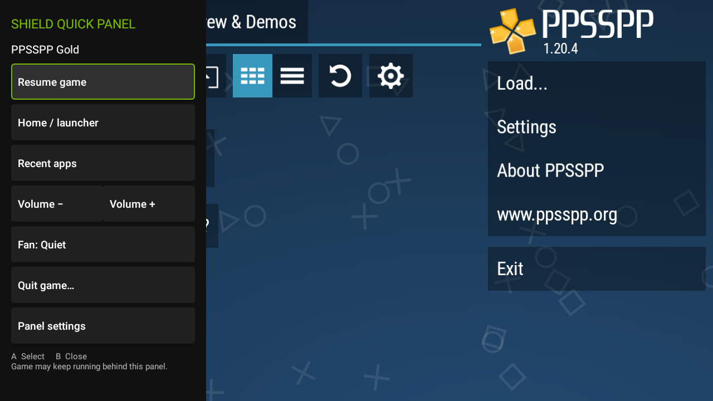
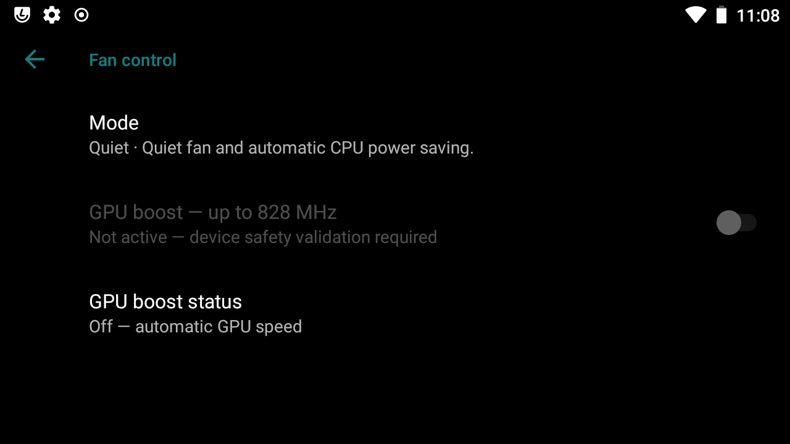
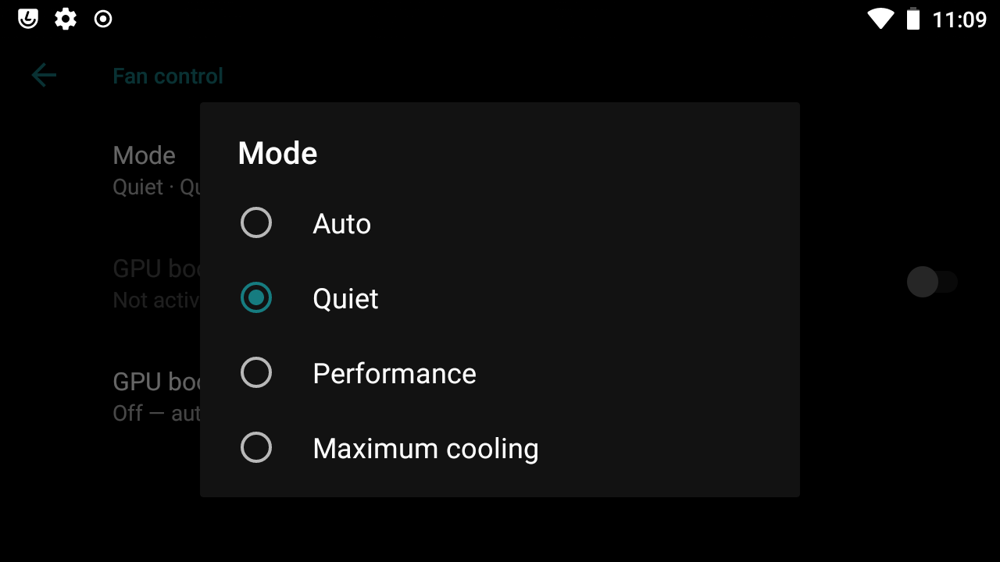
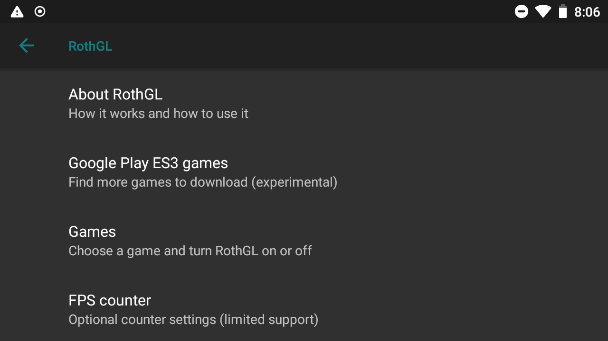

# SHIELD settings

[← Home & features](../README.md) · [Installation & downloads](INSTALL.md)

Open **Android Settings → Shield settings**.

## Start here

| I want to… | Open |
|---|---|
| Change a button for one app | Controller settings → Built-in controller → App profile |
| Map buttons to touchscreen controls | Controller settings → NVIDIA touchscreen game mapper |
| Pair a wireless SHIELD controller | SHIELD accessories → Pair accessory |
| Change my home screen | Launcher settings |
| Open or disable in-game shortcuts | Quick Panel settings |
| Choose quieter or stronger cooling | Fan control |
| Try graphics compatibility or an FPS counter | RothGL |

On a fresh setup, **Dark** style and the **Black** variant are selected. Change them in **Android Settings → Display → Style**. An upgrade keeps an existing style choice.

## Controller settings

| Choice | What it does |
|---|---|
| Built-in controller | Opens button remapping |
| Enable controller profiles | Turns your saved mappings on or off |
| Global default | Sets the mapping used by all apps |
| App profile | Sets a different mapping for one app |
| Use global setting | Makes that app follow the global mapping |
| NVIDIA button — short press | Changes the short press only |
| Back button | Changes the Back button action |
| Sound button | Changes the Sound button action |
| Test controller | Shows button, stick, and trigger input |
| Reset controller profiles | Deletes mappings and restores original button behaviour |

Button actions:

- **Default suspend/wake:** original NVIDIA short-press behaviour.
- **Default Back / Default volume:** original Back or Sound behaviour.
- **Guide / Mode:** sends a controller Guide button.
- **Select:** sends controller Select.
- **Start:** sends controller Start.
- **Back:** sends Android Back; offered for the Sound button.
- **No action:** ignores that button press.

**Long-press NVIDIA remains the power menu.** The separate Home button stays Home.

### NVIDIA touchscreen Game Mapper

- **On:** allows controller buttons to be placed over touchscreen controls.
- **Off:** disables the mapper.
- **How to open Game Mapper:** open the app and hold **Start**, move the buttons/sticks over its touch controls, then save.

## SHIELD accessories

The wireless-controller settings target the **2015 SHIELD Controller (P2570)**. It uses Wi-Fi Direct, not Bluetooth. Other controller models are not confirmed. **Pairing is unavailable in the current package; repair and retest are pending.**

- **Pair accessory:** opens accessory pairing.
- **Accessory name:** opens its details.
- **Battery:** shows the reported battery level; “not reported” means no level was supplied.
- **Connection:** shows the connection type/status.
- **Device information:** shows details supplied by the accessory.
- **Forget:** removes the pairing; pair again to reconnect.

## Console Mode and HDMI

Connect an HDMI display and open the Console Mode app.

- **Console Mode:** use the external display while the Portable screen is off.
- **Mirror Mode:** restore the Portable display and mirror to HDMI.

Save your game before switching; the display transition can restart Android's interface. Console Mode is restored, but HDMI behaviour still needs a repeat check on the next package.

## Launcher settings

*Example library; games and apps shown are not included.*

- **Startup intro:** play or skip the intro when the launcher starts fresh.
- The public ROM uses the lightweight built-in logo animation; no startup video or intro sound is included.
- **Preview startup intro:** play it now. **A or touch skips.**
- **Quick Panel settings:** opens the sidebar controls below.
- **Android settings:** opens normal Android settings.
- **Controls & about:** shows the button guide.
- **Return to library:** returns to your apps.

In the library, **Cover / icon** chooses artwork or restores the original icon. This does not uninstall the app. **Y** changes favourite status where offered.

### Launcher buttons

**D-pad / left stick:** move. **A:** select/details. **B:** back. **X:** quick launch. **L1/R1:** change tabs. **L2/R2:** change Games/Apps filters. **Start:** open or close the menu.

## Quick Panel

Open **Launcher settings → Quick Panel settings**.

- **Enable Quick Panel:** master on/off switch.
- **Left-edge swipe:** opens it with an inward swipe from the left handle.
- **Long-press Back:** opens it after holding Back for about 0.6 seconds.
- **Preview sidebar:** tries it without opening another app.
- **Android accessibility service:** enables the service needed for these shortcuts.
- **Help & controls:** shows the shortcut guide.

### Per app settings

- **Use global settings:** follow the main shortcut switches.
- **Disabled in this app:** hide the sidebar and disable its shortcuts here.
- **Custom shortcuts:** choose swipe and long-press Back separately for this app.

The master switch must still be on. If Back is mapped to Select/Guide, use swipe instead. Exclude a streaming app if the sidebar interferes with its controls.

### Sidebar choices

*Quick Panel captured on the SHIELD. The background app is not included.*

**Resume:** close the sidebar. **Home:** open the launcher. **Recent apps:** show open apps. **Volume −/+ :** change media volume. **Fan:** cycle cooling modes. **Quit:** close the current app after confirmation. **Settings:** open panel settings.

Opening the panel may not pause the app. Quit can lose unsaved progress.

## Fan control

- **Quiet:** quiet cooling and automatic CPU power saving.
- **Performance:** stronger cooling and all four CPU cores available; uses more battery.
- **Maximum cooling:** strongest cooling and all four CPU cores available; louder and uses more battery.
- **Auto:** Performance for selected foreground apps; Quiet elsewhere and when the screen is off.
- **Apps with extra cooling:** choose the apps used by Auto.

Auto needs the Quick Panel accessibility service to follow the current app. The sidebar master switch can stay off if you only want Auto cooling. Disabling the service releases Auto's Performance request; choose Quiet if you stop using Auto.

Quiet does not mean the fan immediately stops: it may keep running while the device cools down. Manual Performance and Maximum cooling do not automatically become Quiet when the screen turns off.

**GPU boost is unavailable in this ROM. Leave it off. Overclock settings are unavailable.**

## RothGL

Optional graphics compatibility settings. It does not provide complete ES3 support. Leave it off unless needed.

### Main choices

- **About RothGL:** short explanation and help.
- **Google Play ES3 games:** opens the store visibility options.
- **Games:** selects an installed app.
- **FPS counter:** opens the frame-counter options.

### Google Play ES3 games

- **Show more ES3 games:** changes which apps Google Play may offer. Turning it off restores normal reporting. Download availability is not a guarantee that an app will run.
- **Open Google Play:** opens the store.
- **Download vs play:** explains the difference.

### Games

- **Search games:** finds an entry.
- **Add a missing game:** adds an installed app to the list.
- **Use RothGL:** on for the selected app; off for normal graphics.
- **Open game:** opens the selected app.
- **Use normal graphics:** removes an older graphics profile when shown.
- **Advanced settings:** opens the extra choices below.

Save progress before applying a graphics change: it closes the selected app. Turning it off keeps installed files and saves.

### Advanced settings

- **Graphics library — Automatic:** keeps the suggested library.
- **Other listed libraries:** manually chooses another available library.
- **Apply library choice:** closes the app and uses that choice.
- **FPS counter:** sets the counter for this app.
- **Older compatibility options:** opens the optional compatibility switches below.
- **Technical status / Game version:** displays information; changes nothing.
- **About RothGL:** opens help.

### Older compatibility options

Keep these off unless you need a specific workaround. They replace the selected graphics profile, rather than adding to it.

- **Enable legacy compatibility layer:** enables the older graphics path.
- **Advertise ES3 to this game:** changes the graphics version reported inside this app.
- **ES3 context-version compatibility:** adjusts graphics-context version reporting.
- **Blur-shader workaround:** changes blur processing where this option is available.
- **Android UI compatibility:** changes how the app's Android menus are drawn.
- **Use verified older profile:** applies the offered saved profile when available.
- **Apply custom profile:** saves and applies your selected switches.
- **Use normal graphics:** turns the profile off.

### FPS counter

- **Show FPS counter:** default on/off for supported profiles.
- **Position:** Top right, Top left, Bottom right, or Bottom left.
- **For this app:** Use global setting, Show, or Hide.
- **Counter support:** explains availability.

The counter needs a compatible graphics profile. Enabling it does not enable RothGL, and the number may differ from frames actually displayed.

## App Fixes

Not included in this ROM. RothGL graphics settings remain available separately.

## SHIELD Tester

Not included in this ROM. Button remapping and the controller test inside SHIELD settings remain available.
